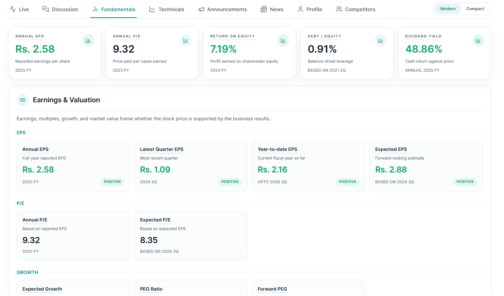
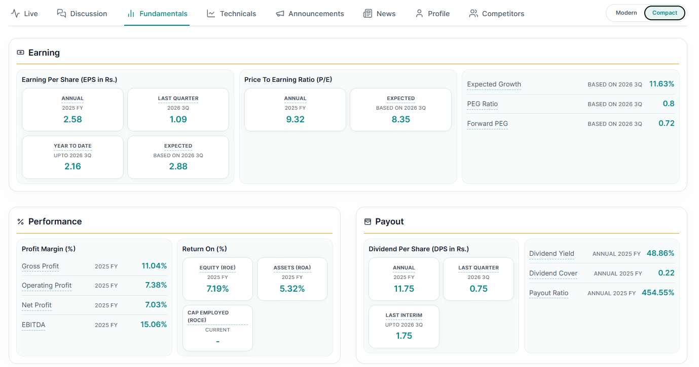

# Approved UI references

User-provided samples saved 2026-11-06. These guide repairs to the existing Comfortable, Compact and Console modes, not new modes or financial formulas.

- [Modern](modern-reference.png): prominent primary values, supporting labels/periods, bordered metric tiles, section dividers and local charts.
- [Compact](compact-reference.png): tight metric groups, short rows, aligned values/dates and restrained containers.
- Only top-level sections collapse. Currency summaries, charts and tables stay open inside them.
- Main figure > supporting balances > extra statistics; units and dates remain visible.
- Theme tokens vary visual treatment. Do not introduce another layout preference: preserve the three existing density modes.
- Alerts expose an accessible close button; required confirmation content may disable dismissal.

